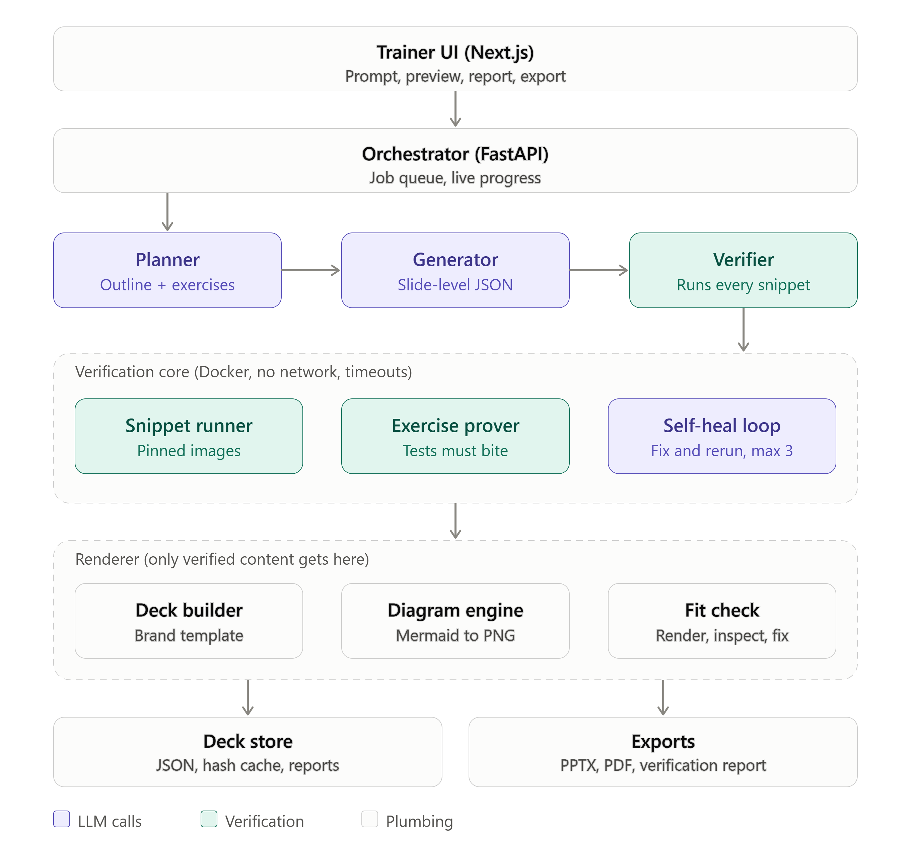

# Verified Course Material Studio

_Team **pandavs**: not a single weak character._

Generates training decks (slides, exercises, quiz, cheat sheet) where **every code snippet is run in a Docker sandbox before it reaches you**. Nothing ships unverified.

```
Planner -> Generator -> Verifier (Docker sandbox) -> Renderer
```



> Status: prototype, built phase by phase from [`guide1.md`](guide1.md). Currently at **Phase 0 (skeleton)**.

## Quick start
```powershell
Copy-Item .env.example .env   # then fill ANTHROPIC_API_KEY and CLAUDE_MODEL
docker compose up --build
```
- Web: http://localhost:3000
- API: http://localhost:8000/health (docs at `/docs`)

## Run API tests locally
```powershell
python -m venv .venv
.venv\Scripts\pip install -r apps/api/requirements.txt
cd apps/api; ..\..\.venv\Scripts\python -m pytest -m "not slow"
```

## Layout
| Path | What |
|---|---|
| `schema/deck.schema.json` | Single source of truth for deck JSON |
| `apps/api` | FastAPI orchestrator (planner, generator, store) |
| `apps/web` | Next.js + Tailwind UI |
| `services/verifier` | Sandbox runner, exercise prover, self-heal |
| `services/renderer` | PPTX/PDF builder, diagrams, fit check |
| `sandbox/` | Pinned Java 21/Spring Boot 3 and Python 3.12 images |
| `docs/` | API contract, schema notes, demo script |
| `samples/` | Sample/backup decks |

See [docs/api-contract.md](docs/api-contract.md) and [docs/deck-schema.md](docs/deck-schema.md).
